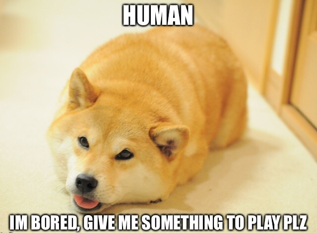

# Welcome to the Cheems Project

This repository contains the source code and assets for the Cheems.me website, a fun space dedicated to the Cheems meme.

[Site Link](https://cheems.me)

## About Cheems

During the quarantine, "Cheems" gained popularity because it captured the generational shifts, the fear that the COVID-19 pandemic is causing, and the ambiguities of the modern world. His photograph went viral after his owner posted a shot on Instagram about how much his dog loves cheeseburgers.

## How You Can Contribute

We welcome contributions to make this site even better! Here are a few ways you can help:

*   Suggestions for updates are welcome.
*   Help improve the user interface.
*   Feel free to add new memes or write more about Cheems.

## Support Us

If you like this project, please consider starring this repository! Your support is appreciated.

## Don't forget Doge

## More Memes

## Meet Our Contributors

We are grateful to all our contributors. You can see a list of everyone who has contributed to this project on [GitHub](https://github.com/[YOUR_USERNAME_OR_ORG]/[YOUR_REPO_NAME]/graphs/contributors). Please replace the bracketed placeholders with the actual owner and repository name.

Thank You

Cheemsburger :)
